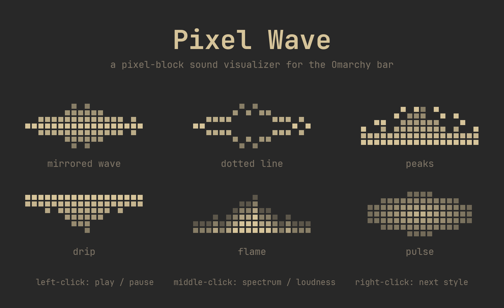

# Pixel Wave

A pixel-block sound visualizer for the [Omarchy](https://omarchy.org) bar. It reacts to whatever is playing and rests as a flat line of dots when it's quiet.



- **Spectrum** (default) shows frequency bands from [cava](https://github.com/karlstav/cava). The bass sits in the middle, so music draws a mirrored wave.
- **Loudness** scrolls the volume of what's playing across the widget. It uses PipeWire's peak monitor and needs nothing extra.
- **Seven styles**: mirrored wave, equalizer, dotted line, equalizer with falling peak caps, bars dripping from the top, flames that fade at their tips, and a pulse that glows from the middle with the volume.
- **Mic mode**: while [Voxtype](https://voxtype.io) is recording, the widget shows your microphone in the theme's accent colour, so you can see it hears you.
- It follows your theme colours and Omarchy's language setting (English and Polish included).

## Requirements

- Omarchy with the Quickshell-based Omarchy shell (shell plugins)
- Optional: `cava`, from the Arch `extra` repository, for the spectrum view. Without it the widget shows loudness.
- Optional: Voxtype for mic mode. Without it, mic mode stays off.

## Install

```bash
omarchy plugin add https://github.com/wojciech-ratajczak/omarchy-pixel-wave --enable
```

It lands on the right side of the bar. To put it somewhere else:

```bash
omarchy bar move io.github.wojciech-ratajczak.pixel-wave --section left
```

## Remove

```bash
omarchy plugin remove io.github.wojciech-ratajczak.pixel-wave
```

This removes the plugin folder and its bar entry. The only other file it creates is a small cava config under `$XDG_RUNTIME_DIR/omarchy-pixel-wave/`, which disappears when you log out.

## Use

| Input | Action |
|-------|--------|
| Left-click | Switch between spectrum and loudness |
| Right-click | Next style: mirrored wave → equalizer → dotted line → peaks → drip → flames → pulse (or only the ones listed in `styles`) |

Both choices are saved in `~/.config/omarchy/shell.json`. The same actions are available over IPC, for keybindings:

```bash
omarchy-shell io.github.wojciech-ratajczak.pixel-wave cycleStyle
omarchy-shell io.github.wojciech-ratajczak.pixel-wave toggleData
omarchy-shell io.github.wojciech-ratajczak.pixel-wave status
```

## Settings

These keys go in the widget's entry in `~/.config/omarchy/shell.json`, under `bar.layout`:

| Key | Default | Values |
|-----|---------|--------|
| `style` | `"mirror"` | `mirror`, `bars`, `dots`, `peaks`, `drip`, `flame`, `pulse` |
| `styles` | all seven | The styles right-click cycles through, in this order: an array such as `["bars", "peaks", "pulse"]`, or a comma-separated string such as `"bars,peaks,pulse"`. Unknown names and repeats are ignored; an empty list means all styles. |
| `data` | `"spectrum"` | `spectrum`, `loudness` |
| `columns` | `18` | 6–48 |
| `cellSize` | `2` | Pixel size in px, 1–6. Bigger pixels mean fewer rows fit. |
| `framerate` | `30` | Spectrum frame rate, 10–60 |
| `color` | `"foreground"` | `foreground`, `accent` |
| `activeMonitorOnly` | `false` | With several monitors, show it only on the focused monitor's bar |
| `showGrid` | `false` | Draw unlit pixels faintly |
| `micMode` | `true` | Show the microphone while Voxtype records |
| `hideWhenIdle` | `false` | Leave the bar while nothing plays and the microphone is not shown, instead of resting as a flat line of dots |

Example:

```json
{ "id": "io.github.wojciech-ratajczak.pixel-wave", "style": "bars", "columns": 24, "color": "accent" }
```

## How it works

- `Service.qml` runs once per shell. It owns the audio capture and publishes levels, and each monitor's `BarWidget.qml` draws them.
- Capture runs only while an application has a playback stream open (plus 3 seconds), or while Voxtype records.
- The spectrum comes from `cava`, started through `cava-run` with raw ASCII output. If cava is missing or keeps crashing, the widget falls back to loudness.
- Loudness adjusts its own gain: the wave spans 9 dB under the loudest recent level, so quiet speech and loud music both fill it.
- Mic mode follows `voxtype status --follow --format json`.
- The plugin makes no network requests.

## Development

```bash
node tests/run.mjs        # tests for the pure helpers in PixelWave.js
```

Edits to `BarWidget.qml` hot-reload. In testing, edits to `Service.qml` or `PixelWave.js` only took effect after `omarchy restart shell`.

## License

[MIT](LICENSE) © 2026 Wojciech Ratajczak

<sub>Built with help from [Claude Code](https://claude.com/claude-code).</sub>
